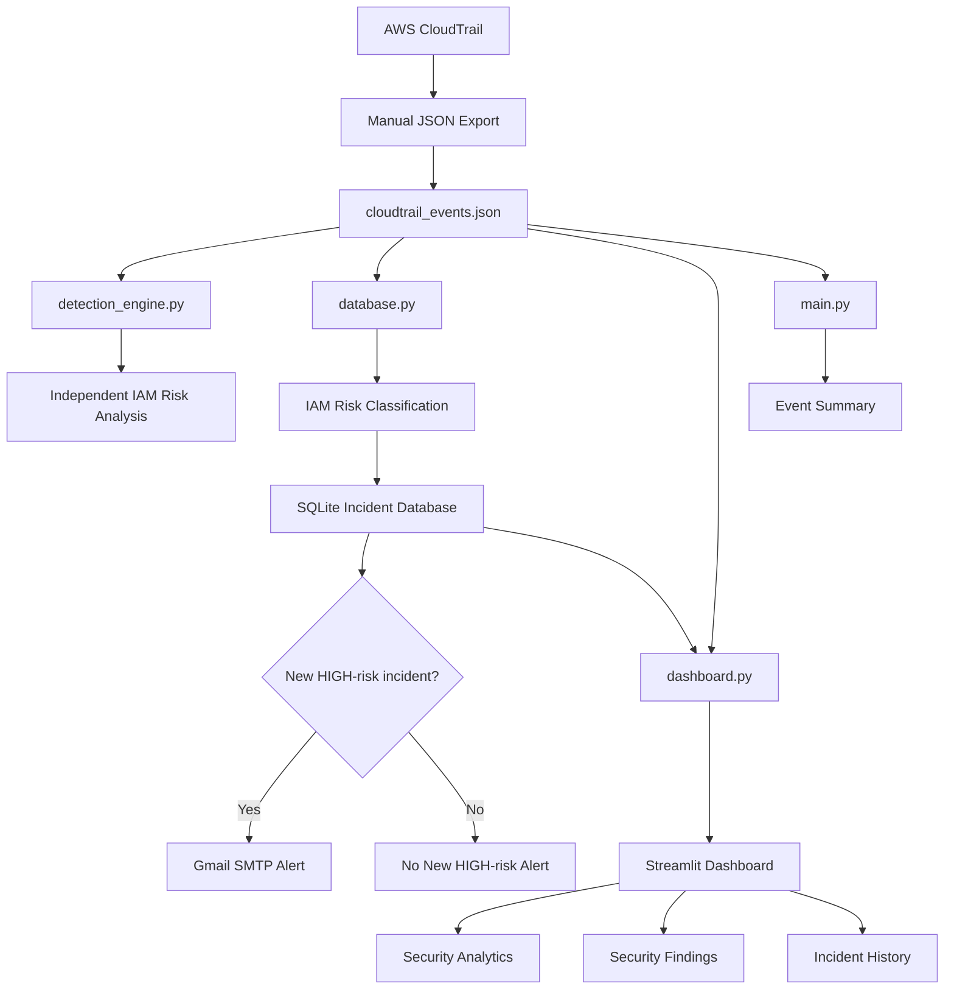

# PrivilegePulse - System Architecture

## Architecture Explanation

1. **AWS CloudTrail:** Records activity within the AWS environment.
2. **Manual JSON Export:** CloudTrail event history is exported as a JSON file.
3. **Detection Engine:** `detection_engine.py` independently analyses IAM events using predefined detection rules.
4. **Database Processing:** `database.py` independently classifies events and stores incident records in SQLite.
5. **Email Alerts:** Gmail SMTP sends alerts for newly recorded HIGH-risk incidents.
6. **Streamlit Dashboard:** `dashboard.py` reads the exported JSON and SQLite incident records to display security findings, analytics and incident history.
7. **Event Summary:** `main.py` independently reads the exported JSON and displays event summaries.

## Important Implementation Notes

- The current implementation uses manually exported CloudTrail logs; it does not provide real-time monitoring.
- Risk classifications are rule-based indicators and do not prove that an activity is malicious.
- Events without an error code are labelled "NO ERROR RECORDED"; this does not independently guarantee successful execution.
- The detection, database and dashboard modules currently contain separate analysis logic.

