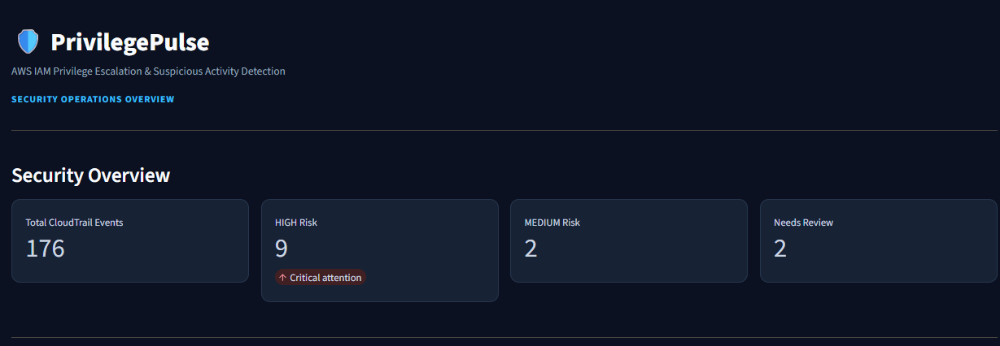
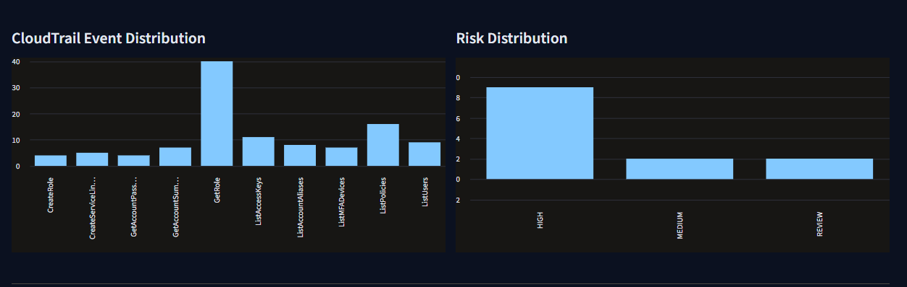
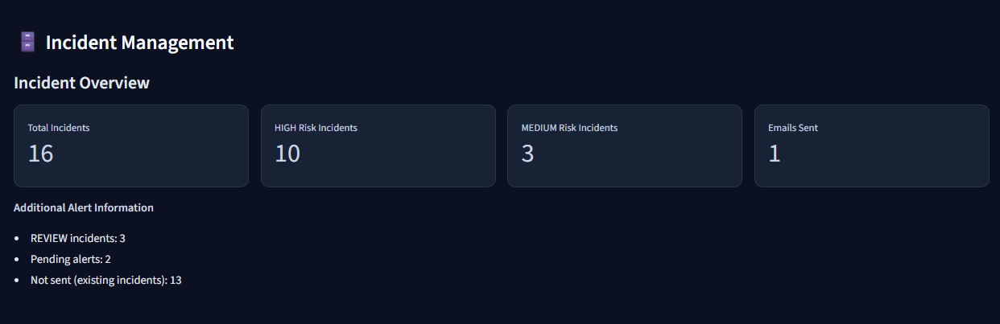

# 🛡️ PrivilegePulse
### AWS IAM Privilege Escalation & Suspicious Activity Detection System

PrivilegePulse is a Python-based cloud security analysis tool designed to identify potentially suspicious AWS IAM activities using AWS CloudTrail event logs.

It analyses CloudTrail JSON records, classifies IAM activities based on predefined risk rules, stores security incidents in an SQLite database, and sends email notifications for newly detected HIGH-risk incidents.

## 🚀 Key Features

- **CloudTrail Log Analysis:** Analyses exported AWS CloudTrail JSON event records.
- **IAM Threat Detection:** Identifies potentially suspicious IAM operations.
- **Risk Classification:** Categorises events into HIGH, MEDIUM and REVIEW.
- **Incident Management:** Stores detected incidents using SQLite.
- **Duplicate Prevention:** Prevents duplicate incident insertion using event IDs.
- **Email Notifications:** Sends Gmail SMTP alerts for newly recorded HIGH-risk incidents.
- **Security Dashboard:** Provides a Streamlit-based SOC-style dashboard with charts, findings and incident history.

## 🧰 Technologies Used

| Technology | Purpose |
|---|---|
| Python | Core application logic |
| AWS CloudTrail | Activity log source |
| SQLite | Incident database |
| Streamlit | Security dashboard |
| Pandas | Data processing |
| JSON | CloudTrail log format |
| Gmail SMTP | Email notifications |
| Python dotenv | Environment configuration |

## 🏗️ Project Architecture

1. AWS CloudTrail exports event records in JSON format.
2. The Python detection engine analyses the records.
3. IAM events are classified according to predefined risk rules.
4. Detected incidents are stored in SQLite.
5. HIGH-risk incidents trigger email notifications.
6. The Streamlit dashboard displays security findings and incident history.

## ⚠️ Risk Classification

| Risk Level | Description |
|---|---|
| HIGH | Potentially sensitive IAM operations such as DeleteRole, CreateAccessKey and policy modifications |
| MEDIUM | Monitored IAM operations such as DetachRolePolicy and DeleteRolePolicy |
| REVIEW | Events containing an errorCode, requiring further investigation |

**Note:** Risk labels are preliminary indicators based on predefined rules. A HIGH classification does not automatically prove malicious activity. CloudTrail event details should be investigated before drawing conclusions.

## 📊 Dashboard

The dashboard provides:

- Total CloudTrail event count
- HIGH, MEDIUM and REVIEW metrics
- CloudTrail event distribution
- Risk distribution charts
- Security findings
- Incident history
- Email alert status

## 🧪 Testing

The detection system was tested using simulated IAM events:

| Test Scenario | Event | Expected Result |
|---|---|---|
| HIGH-risk activity | CreateAccessKey | HIGH |
| MEDIUM-risk activity | DetachRolePolicy | MEDIUM |
| Failed IAM operation | CreateAccessKey with AccessDenied | REVIEW |

Additional testing verified incident storage, email notifications and duplicate prevention.

## ⚙️ Local Setup

### 1. Clone the repository

```bash
git clone YOUR_GITHUB_REPOSITORY_URL
cd PrivilegePulse
```

### 2. Create a virtual environment

```bash
python -m venv .venv
```

### 3. Activate the environment

Windows PowerShell:

```powershell
.\.venv\Scripts\Activate.ps1
```

### 4. Install dependencies

```bash
pip install streamlit pandas python-dotenv
```

Install any additional dependencies required by the project.

### 5. Configure environment variables

Create a `.env` file in the project root:

```env
SMTP_EMAIL=your_email@gmail.com
SMTP_APP_PASSWORD=your_google_app_password
ALERT_EMAIL=recipient_email@gmail.com
```

Never publish this file or share your credentials.

### 6. Run the dashboard

```bash
python -m streamlit run dashboard.py
```

## 🔐 Security Considerations

- Never commit `.env` files or email credentials.
- Do not publish real AWS CloudTrail logs.
- Do not expose AWS account IDs, principal IDs or sensitive IP information.
- Use sanitised demonstration data in public repositories.

## 📌 Current Limitations

- Analyses manually exported CloudTrail JSON files.
- Does not currently provide continuous or real-time AWS monitoring.
- Detection is based on predefined event-name and error-code rules.
- Risk classifications require human investigation and verification.

## 🔮 Future Enhancements

- Continuous CloudTrail monitoring.
- Advanced IAM privilege escalation detection.
- Improved contextual risk scoring.
- Additional alerting and incident response capabilities.
- Enhanced cloud security analytics.

## 👩‍💻 Project Information

**Project:** PrivilegePulse  
**Domain:** Cloud Security / Cybersecurity  
**Primary Language:** Python  
**Dashboard:** Streamlit

---

*Built as a cybersecurity learning project to explore AWS IAM security, CloudTrail analysis, threat detection and incident management.*


## 📸 Dashboard Preview

### Security Overview


### Security Analytics


### Incident Overview

